# Underwater ROV controller (Raspberry Pi 4 + 4× BTS7960 + PS5/PS4 controller)

The Pi in the case reads a Bluetooth (or USB) game controller and drives the 4 thrusters
through 4 BTS7960 (IBT-2) boards. Everything runs above water; only the motor wires go down the tether.

## Install or update: one command
On the Pi (fresh Raspberry Pi OS or an existing ROV Pi), connected to the internet by **Wi-Fi** or Ethernet. Open a terminal and run:
```bash
curl -fsSL https://raw.githubusercontent.com/codemastervy/underwater-rov/main/setup.sh | bash
```
- **New Pi:** installs everything (Python libraries, Bluetooth, ffmpeg), the `rov` service, the dashboard autostart and
  the 800x480 screen setting. Then `sudo reboot`. To leave the screen setting alone, use `... | ROV_SCREEN=none bash`.
- **Already installed:** downloads the latest version and restarts the program and dashboard. Your motor flips,
  drive profiles and camera settings are kept.
- Nothing needs installing first, not even git.
- **After that you never need the command again:** the dashboard checks GitHub for a new version when it starts and every
  30 minutes (whenever the Pi has internet). When there is one, the main page shows **⬆ UPDATE READY**; tap it (or
  **SETUP › EXTRAS › UPDATE NOW**) while SAFE. It downloads, installs and restarts by itself in under a minute.
  Settings are kept. No internet (at the pool)? It just says so and tries again later.

## Screenshots
The dashboard (800x480), captured running on a computer with simulated ROV data; the camera picture is a placeholder:

| Main (armed, driving) | Camera + picture adjustments |
|---|---|
| 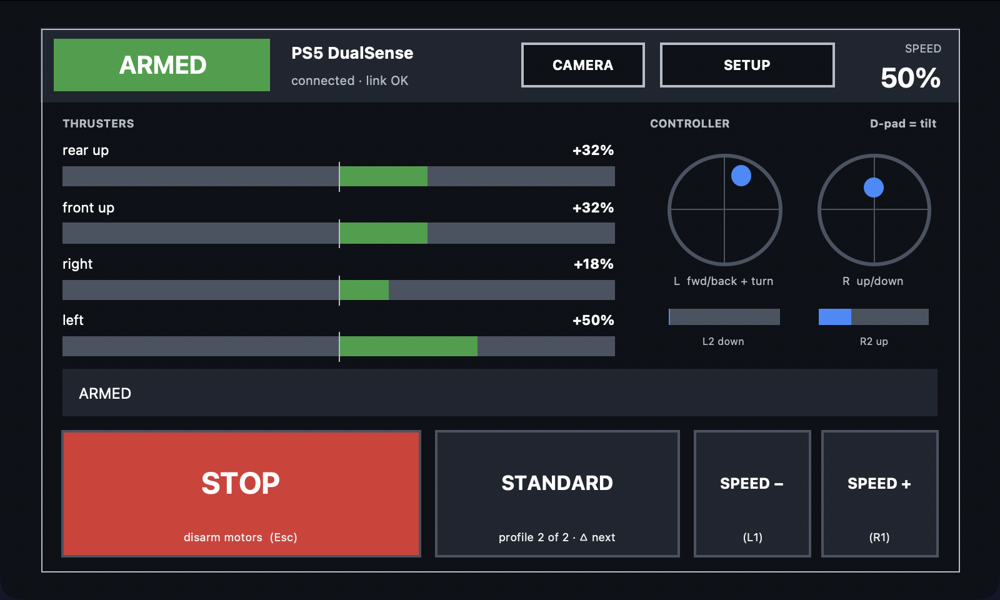 | 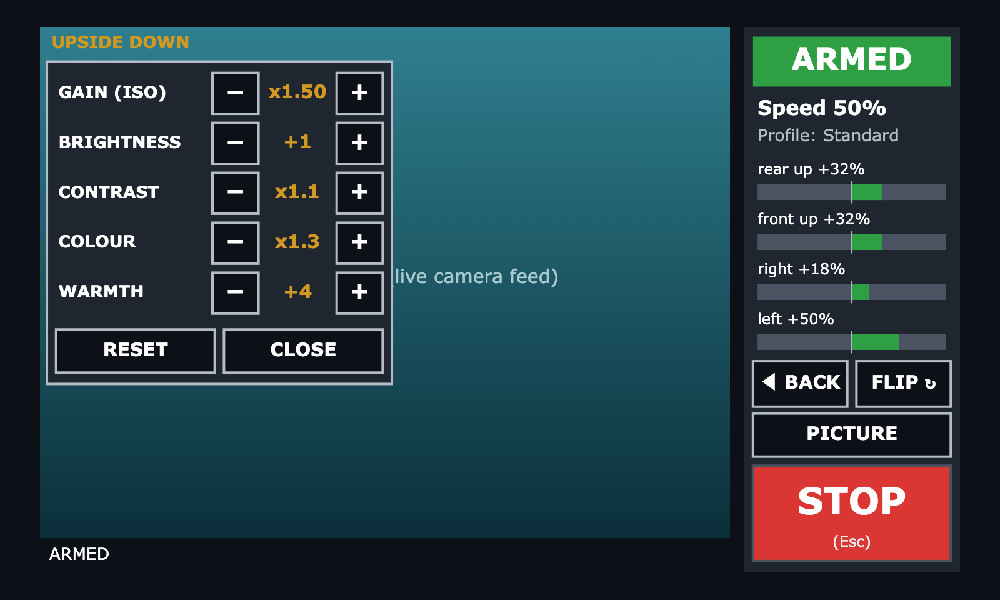 |
| **SETUP › EXTRAS** (keyboard drive, arm tune, software update) | Keyboard driving |
| 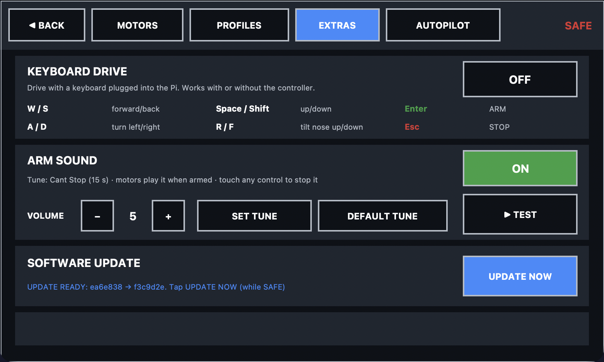 | 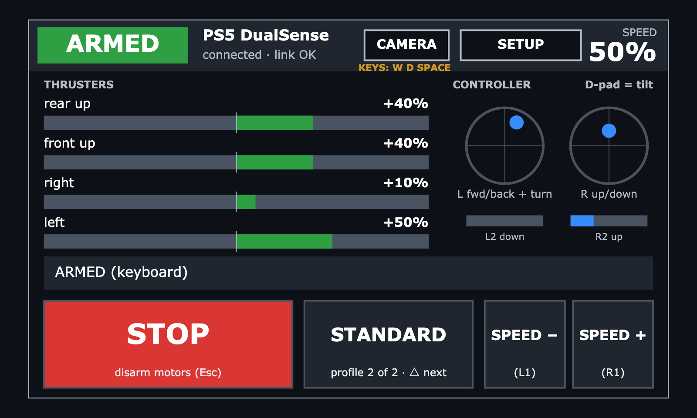 |
| **SETUP › MOTORS** (flip motors) | **SETUP › PROFILES** (profile editor) |
| 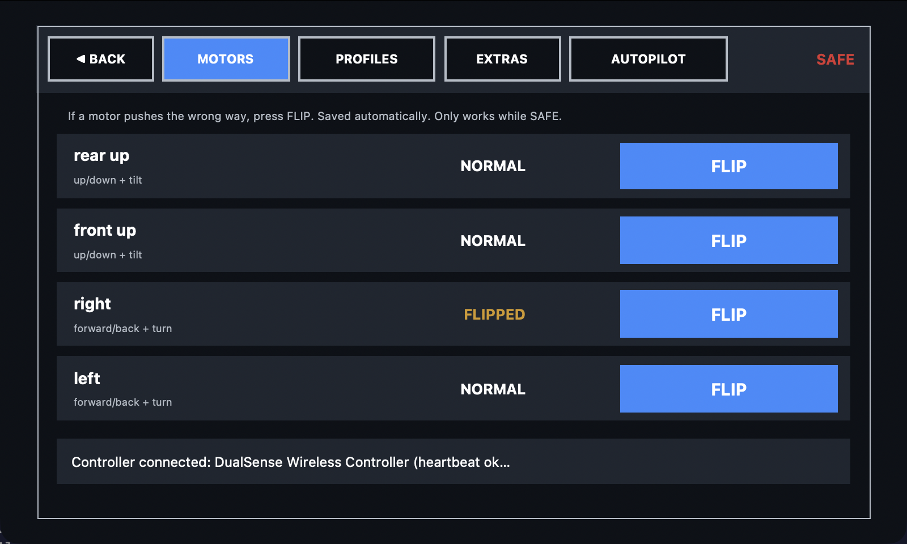 | 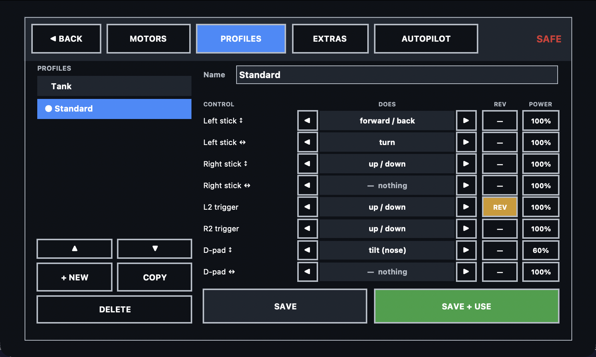 |
| **SETUP › AUTOPILOT** | Mission editor |
| 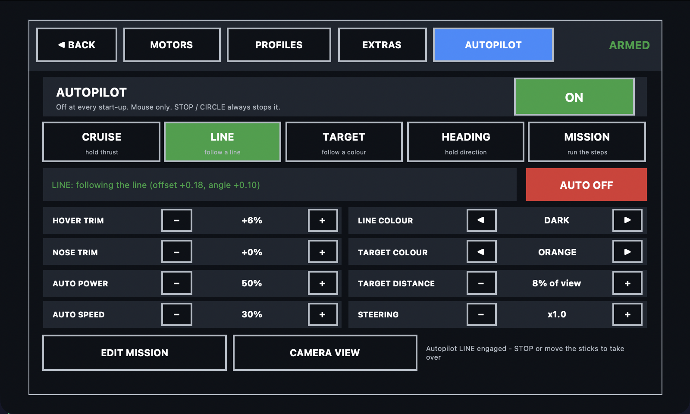 | 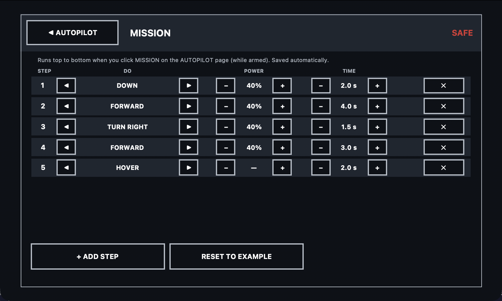 |
| Autopilot working (green) | Autopilot unsure: take control (flashing red) |
| 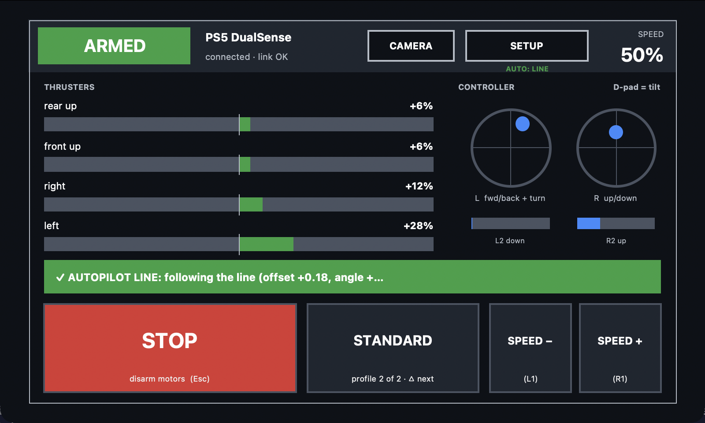 | 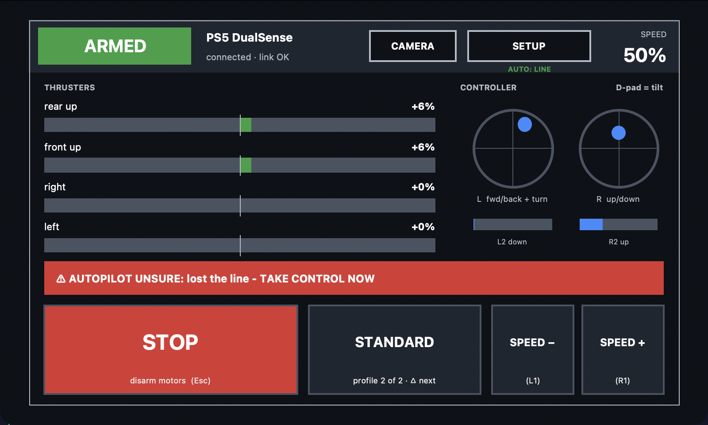 |
| Line following (camera view) | PICK: click an object to follow its colour |
| 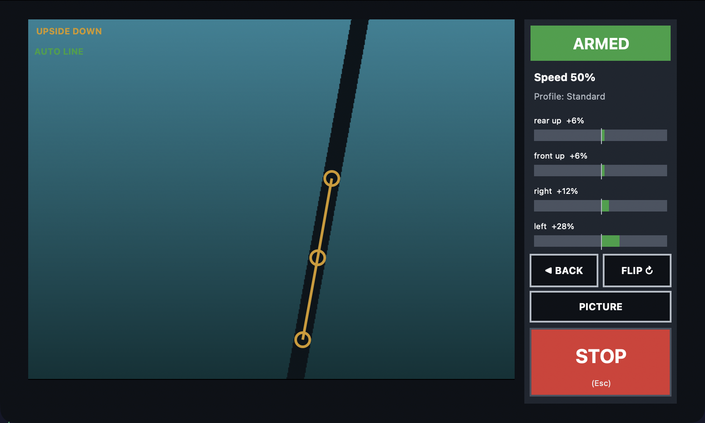 | 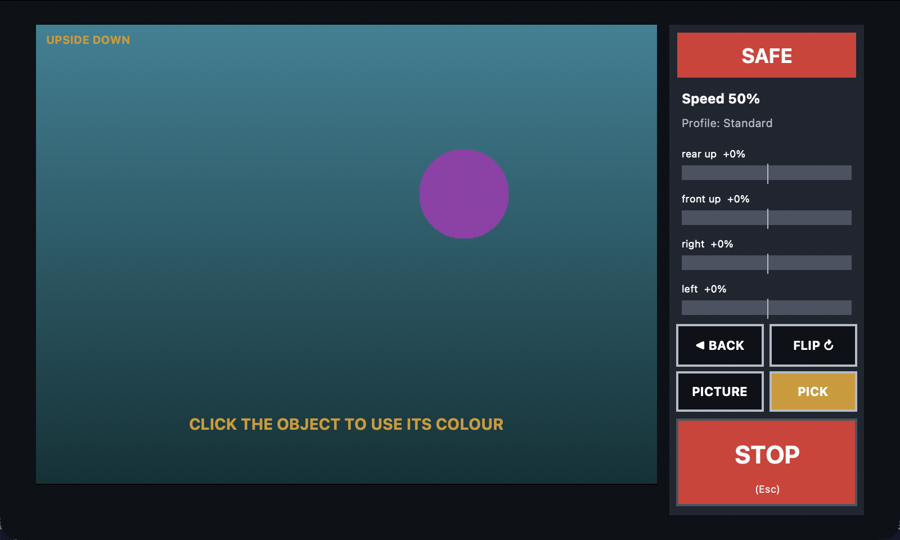 |
| SET TUNE: paste a ringtone | |
| 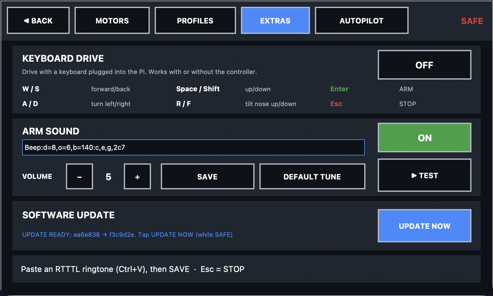 | |

## Files
| File | What it is |
|---|---|
| `rov.py` | the motor program (controller → motors), runs as the `rov` service |
| `rov_gui.py` | full-screen dashboard for the 800x480 case monitor (status, motor flip, profile editor, camera) |
| `config.toml` | pins, motor layout, speeds, safety settings |
| `profiles.json` | drive profiles (edited on the screen: SETUP > PROFILES) |
| `camera.json` | camera flip setting |
| `setup.sh` | one-command install / update from GitHub (see above) |
| `updater.py` | automatic updates from GitHub (used by the dashboard) |
| `install.sh` | installs everything on the Pi and starts it on boot |
| `pair-controller.sh` · `rov-autopair.sh` | pair a PS5/PS4/other Bluetooth controller · auto-pairing service |

The ready-to-flash Pi OS image (login `pi` / `raspberry`, hostname `rov`, SSH on, Ethernet only) is too big for
GitHub and isn't in this repo.

## Wiring

Pin numbers: **GPIO** = what goes in `config.toml`, **Pin** = physical pin on the Pi header (pin 1 is the corner nearest the SD card end, marked with a square pad).

| BTS7960 board | RPWM | LPWM | R_EN + L_EN | VCC | GND |
|---|---|---|---|---|---|
| Motor 1 (rear up)  | GPIO12 / Pin 32 | GPIO13 / Pin 33 | GPIO17 / Pin 11 | 3.3V Pin 1 or 17 | any GND |
| Motor 2 (front up) | GPIO19 / Pin 35 | GPIO26 / Pin 37 | GPIO17 / Pin 11 | 3.3V | GND |
| Motor 3 (right)    | GPIO16 / Pin 36 | GPIO20 / Pin 38 | GPIO17 / Pin 11 | 3.3V | GND |
| Motor 4 (left)     | GPIO24 / Pin 18 | GPIO25 / Pin 22 | GPIO17 / Pin 11 | 3.3V | GND |

Pi GND pins: 6, 9, 14, 20, 25, 30, 34, 39.

- **All 8 enable pins (R_EN and L_EN on every board) go to GPIO17.** The program only turns this on while armed,
  so the motors are physically disabled at boot, after a crash, or if the controller drops out.
  Add a **10 kΩ resistor from GPIO17 to GND** so it stays off while the Pi is booting.
- **VCC on the boards → Pi 3.3 V** (not 5 V). This makes the board's logic match the Pi's 3.3 V signals.
  The boards take only a few mA.
- **Leave R_IS / L_IS unconnected.** They can put out more than 3.3 V and damage the Pi.
- **B+ / B−** → 12 V battery (through a **fuse** and your main switch). **M+ / M−** → motor wires in the tether.
- The Pi needs its own 5 V 3 A supply (a 12 V→5 V USB-C buck converter is fine). The BTS7960's logic ground
  and the battery ground are joined on the board, so the Pi and battery share ground through the GND wire. That is required.
- Optional: wire one of the red panel toggles between **GPIO22 (Pin 15)** and GND, and set `arm_switch_pin = 22`.
  Then motors can only run while that switch is up. That gives you a hardware kill switch.
- Optional: an LED (with a 330 Ω resistor) on GPIO27 (Pin 13), `status_led_pin = 27`. It lights when armed.

## Setup on the Pi

1. Flash `2026-10-06-raspios-trixie-arm64.img` with **Raspberry Pi Imager** → *Use custom* → pick the .img.
   In the settings (gear) set a username/password, Wi-Fi, and enable SSH.
2. Copy this folder to the Pi (USB stick, or `scp -r underwater-rov <user>@<pi>.local:~`).
3. On the Pi:
   ```bash
   cd ~/underwater-rov
   sudo bash install.sh
   sudo reboot
   bash ~/underwater-rov/pair-controller.sh
   ```
4. **Identify the motors** (props in the water or clear of everything):
   ```bash
   sudo systemctl stop rov
   python3 /opt/rov/rov.py --test
   ```
   Each motor spins forward then reverse at 30 %. Then edit `/opt/rov/config.toml`:
   wrong direction → `invert = true`; wrong motor → swap the `rpwm`/`lpwm` pins between entries.
5. `sudo systemctl start rov`. From now on it starts by itself on every boot.

To watch it live on the case's monitor: `sudo systemctl stop rov && python3 /opt/rov/rov.py`.

## Controls

**Printable controller card:** [docs/controller-card.pdf](docs/controller-card.pdf) (A4 landscape, one page) to stick on the case.

| Button | Action |
|---|---|
| **OPTIONS** | **Arm** (sticks, triggers and D-pad must be centred) |
| **CIRCLE**, **CREATE/SHARE**, or **PS** | **Disarm / stop all motors** |
| **TRIANGLE** | next drive profile (while SAFE) |
| **SQUARE** | camera page on / off |
| R1 / L1 | speed level up / down (25 / 50 / 75 / 100 %) |
| Sticks, triggers, D-pad | depend on the drive profile (below) |

It starts at 50 % speed. The motors ramp up smoothly rather than jumping to full power.

### Drive profiles
| | **Standard** | **Tank** |
|---|---|---|
| Left stick | ↕ forward/back, ↔ turn | ↕ left motor |
| Right stick | ↕ up/down | ↕ right motor |
| R2 / L2 | up / down | up / down |
| D-pad ↕ | tilt nose up / down | tilt nose up / down |

Make as many profiles as you like on the case screen with the mouse: **SETUP > PROFILES**. Each control (sticks, triggers,
D-pad) can be set to forward, turn, up/down, tilt, sideways, left side or right side, with its own invert and power.
The profile editor can't be opened from the controller.

### Keyboard drive
Plug a keyboard into the Pi and switch **KEYBOARD DRIVE** on in **SETUP › EXTRAS**. It works with or without the controller.

| Key | Action |
|---|---|
| **Enter** | **ARM** (no keys held) |
| **Esc** | **STOP** |
| W / S | forward / back |
| A / D | turn left / right |
| Space / Shift | up / down |
| R / F | tilt nose up / down |
| + / − | speed up / down |

The dashboard sends the held keys about 20 times a second. If that stops for 0.5 s (dashboard closed or frozen), the keys
count as released, and if no controller is connected the motors disarm.

### Autopilot
**SETUP › AUTOPILOT**, mouse only. The controller can't switch it on, and it is **OFF at every start-up**.
Switch it ON, arm the ROV, then click a mode (click it again or **AUTO OFF** to stop):

| Mode | What it does |
|---|---|
| **CRUISE** | Keeps the thrust you're using when you click it (hold the stick/key, click, let go) |
| **LINE** | Follows a line seen by the camera (pool lane line, tape). Needs the camera to see the bottom |
| **TARGET** | Steers to a coloured object and stops at TARGET DISTANCE |
| **HEADING** | Holds still, facing the same way, using how the camera picture moves (needs a floor/rocks with detail in view) |
| **MISSION** | Runs timed steps (EDIT MISSION: up to 8 steps of forward/back/up/down/turn/tilt/hover) |

**Taking over:** any stick, trigger, D-pad or keyboard-drive key switches the autopilot mode off immediately.
(CRUISE: the input you were holding when you clicked sets the speed; after you let go, the next movement takes over.)

**Target colour:** pick one from the list, or on the camera page press **PICK** and click the object in the video.
Its exact colour (as the camera sees it underwater) becomes the target, shown as "■ PICKED".

Settings: **HOVER TRIM** / **NOSE TRIM** (constant thrust so it hovers level; active whenever the autopilot is ON),
AUTO POWER (most it may use), AUTO SPEED, LINE / TARGET COLOUR, TARGET DISTANCE, STEERING.
CAMERA VIEW shows what it's tracking.

**Status bar** (main and camera pages, only while the autopilot is switched ON):
- **Green ✓**: a mode is engaged and working.
- **Flashing red ⚠ TAKE CONTROL NOW**: it lost the line/target or the camera picture. It hovers, and after 3 s
  switches itself off ("AUTOPILOT OFF – YOU HAVE CONTROL"). Touching any control clears the warning at once.

STOP / CIRCLE / disarm always ends it.
There are no depth or direction sensors, so it can't hold depth and can drift. Always supervise it.

### Arm sound
There is no speaker. When the ROV arms, **the motors play a tune**: they get a very small PWM signal at audio
frequencies so the motor windings whistle, like a 3D printer playing tunes on its motors. The direction swaps each
note so the props don't creep.

- **Default tune: the first 15 seconds of "Can't Stop" (Red Hot Chili Peppers) in beeps**: the muted 16th-note guitar
  intro at 89 BPM, worked out from the recording (pitch + rhythm detection), with the D / E / B notes it plays.
- **Touch any control (stick, trigger, D-pad, WASD) and the tune stops at once** so you can drive straight away.
  STOP / CIRCLE stops it too.
- **SET TUNE**: paste any ringtone in **RTTTL** format (the old Nokia ringtone text, e.g.
  `Name:d=4,o=5,b=120:c,e,g,2c6`; free RTTTL versions of most songs are online), then **SAVE**. Up to 15 s is played.
  **DEFAULT TUNE** goes back to Can't Stop. Your tune is kept in `tune.txt` (survives updates).
- **SETUP › EXTRAS** also has on/off, volume (1–15) and **TEST** (plays it while SAFE; tap again to stop).

### Dashboard (case monitor)
- Main page: armed/SAFE, profile, speed, live motor bars, big **STOP** button.
- **SETUP › MOTORS**: **FLIP** reverses a motor that pushes the wrong way (only while SAFE, saved automatically).
- **SETUP › EXTRAS**: keyboard drive, arm sound and tune, **software update** (version, CHECK NOW / UPDATE NOW).
- **CAMERA**: live feed from the USB capture card. **FLIP** cycles normal → upside down → mirrored.
  **PICTURE** opens the picture controls: **gain (ISO)**, brightness, contrast, **colour** (saturation) and **warmth**
  (adds red / removes blue, which helps underwater). Saved in `camera.json`; RESET goes back to normal.
- Keyboard: Esc = stop (also Space when keyboard drive is off), +/- = speed, p = next profile, c = camera, F11 = full screen.
- If the edges are cut off on another monitor: `python3 /opt/rov/rov_gui.py --margins 30,20,30,20`.

### Thruster layout
Motor power = `surge×forward + yaw×turn + heave×up + sway×sideways + pitch×tilt`, using the numbers in each
`[[motor]]` block of `config.toml`. Default: rear up and front up both lift; tilt pushes them opposite ways;
right and left do forward and turn.

## Safety behaviour
- Starts **disarmed**. The enable line stays low and nothing spins until you press OPTIONS.
- It disarms on: controller disconnect, Bluetooth link going quiet for 0.5 s (uses the PS4/PS5 motion
  sensor stream as a heartbeat), panel switch off, program stop/crash, or pressing CIRCLE.
- After any disconnect you must press OPTIONS again. A controller that reconnects will never start the motors by itself.

## Backup controller options
The program uses **any** gamepad Linux recognises, picked in the order of `preferred` in `config.toml`.
If the main one drops, it switches to whichever other controller is connected (still disarmed until you arm it).

| Controller | Works? | Notes |
|---|---|---|
| PS5 DualSense / DualSense Edge | ✅ best | built-in driver, has heartbeat |
| PS4 DualShock 4 | ✅ best backup | same buttons and same driver behaviour, has heartbeat |
| **Any of the above on a USB cable** | ✅ most reliable | no Bluetooth to drop. Keep a 2–3 m USB-C/micro-USB cable in the case |
| Xbox One / Series | ✅ USB, ⚠️ Bluetooth | over Bluetooth install `xpadneo` for proper support; no heartbeat (relies on disconnect detection) |
| 8BitDo (in XInput/Switch mode), Switch Pro | ✅ | no heartbeat |
| Cheap PS4 clones | ⚠️ | often need `ClassicBondedOnly=false` in `/etc/bluetooth/input.conf` |

## Troubleshooting
- `python3 /opt/rov/rov.py --list` shows every input device the Pi sees.
- `python3 /opt/rov/rov.py --dry-run` tests the controller without touching the GPIO pins.
- `journalctl -u rov -f` shows the service log.
- Motor hums but doesn't turn at low stick: set `min_duty = 15` in config.

