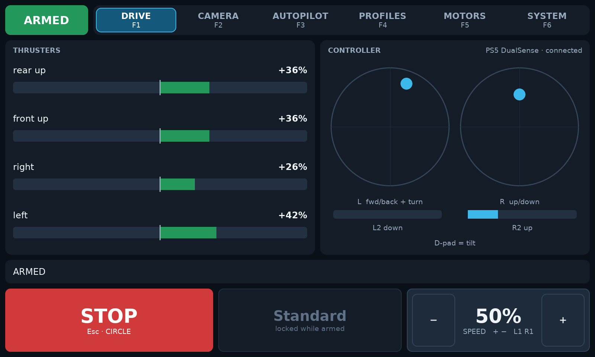
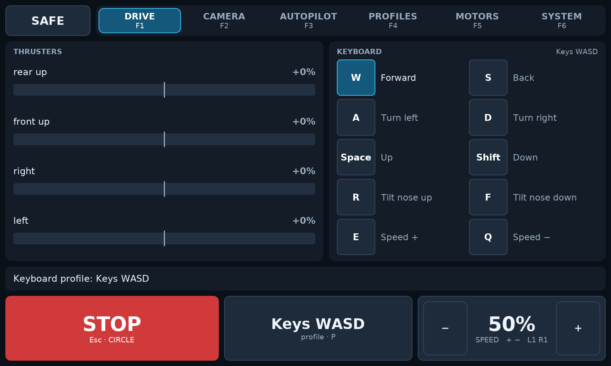
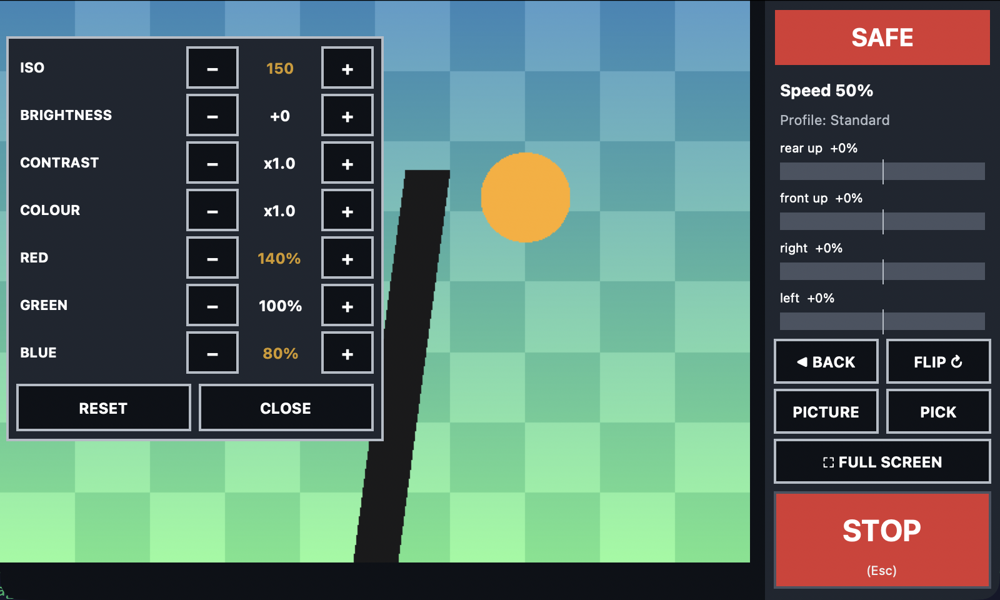
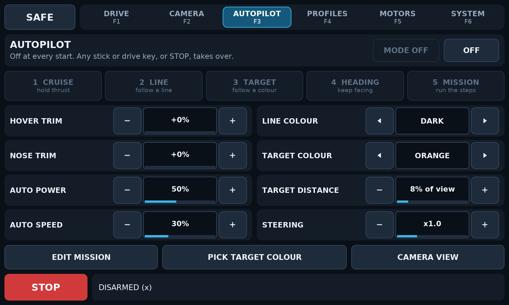
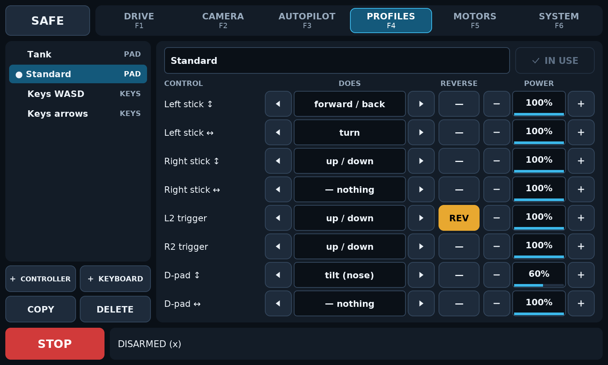
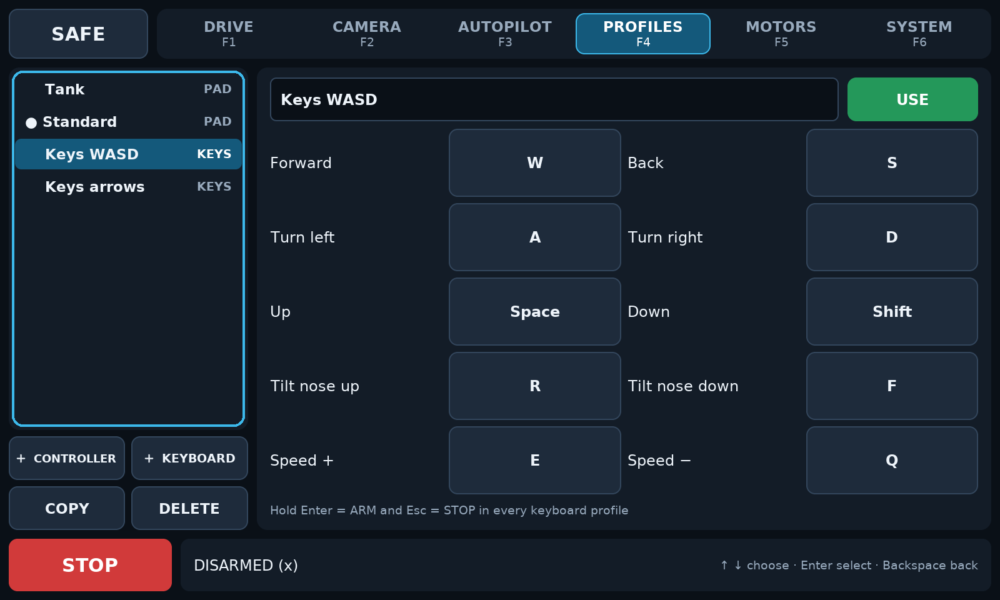
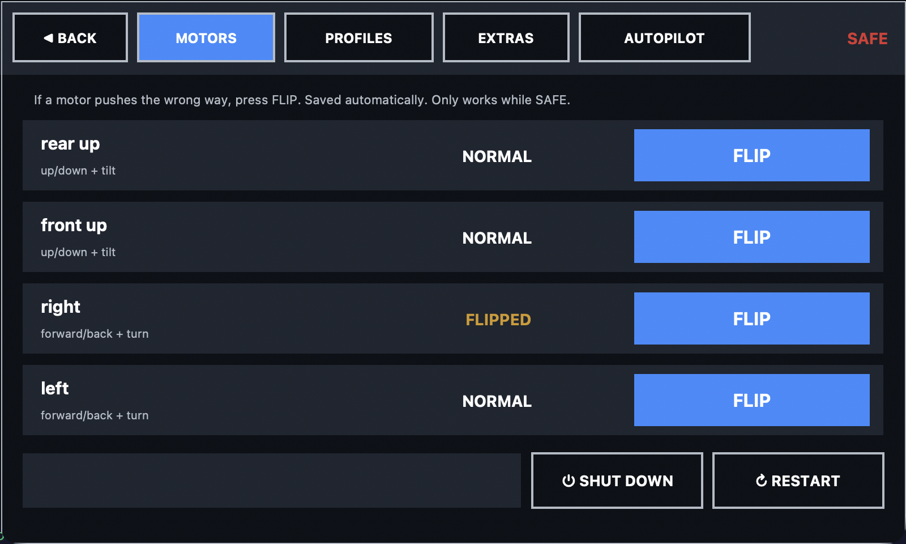
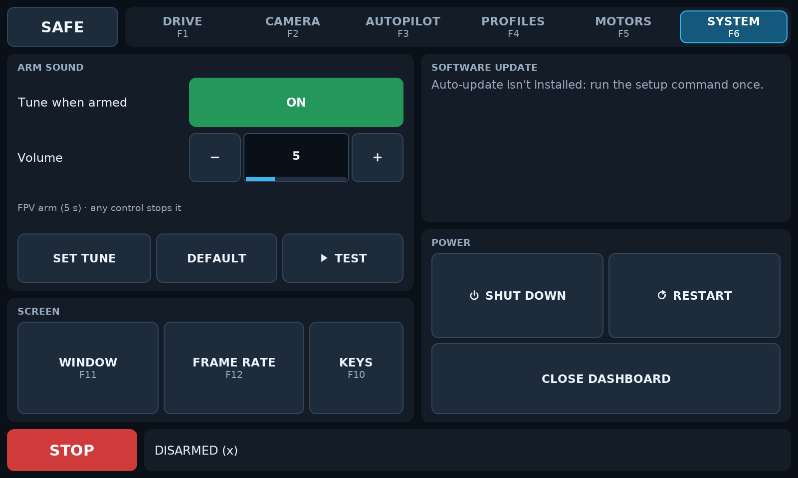
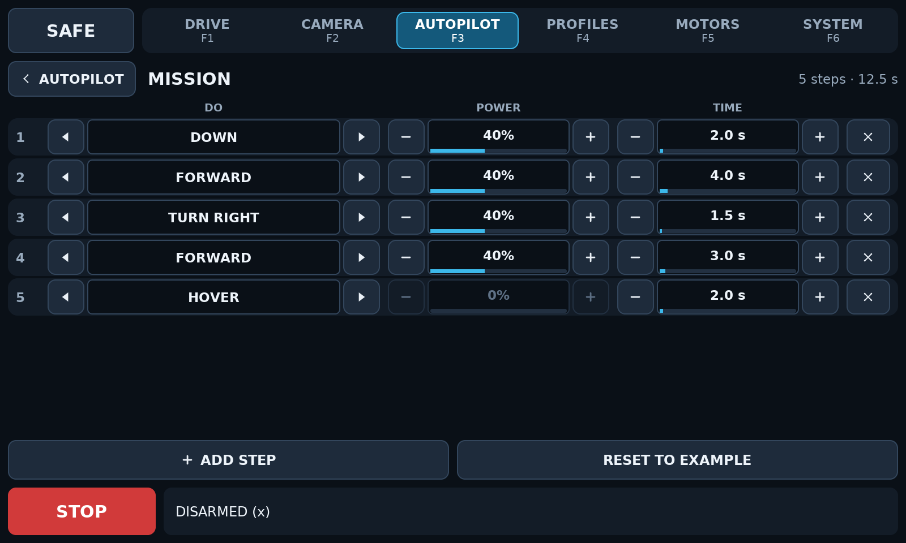
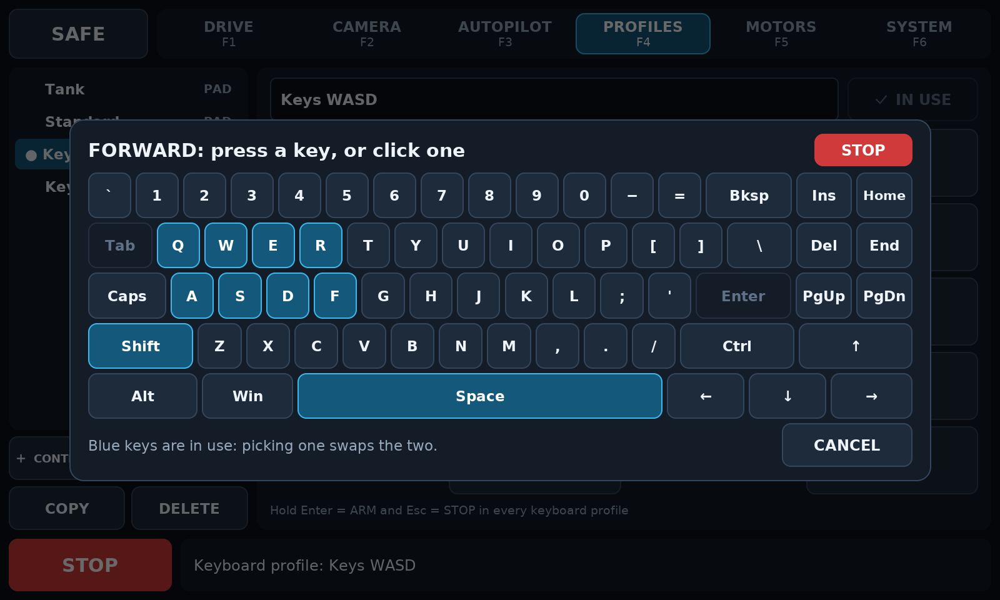

# Underwater ROV controller (Raspberry Pi 4 + 4× BTS7960 + PS5/PS4 controller)

The Pi in the case reads a Bluetooth (or USB) game controller and drives the 4 thrusters
through 4 BTS7960 (IBT-2) boards. Everything runs above water; only the motor wires go down the tether.

## Install or update: one command
On the Pi (fresh Raspberry Pi OS or an existing ROV Pi), connected to the internet by **Wi-Fi** or Ethernet. Open a terminal and run:
```bash
curl -fsSL https://raw.githubusercontent.com/codemastervy/underwater-rov/main/setup.sh | bash
```
- **New Pi:** installs everything (Python libraries, Bluetooth, ffmpeg), the `rov` service, the dashboard autostart and
  the 800x480 screen setting. Then `sudo reboot`. To leave the screen setting alone, use `... | ROV_SCREEN=none bash`.
- **Already installed:** downloads the latest version and restarts the program and dashboard. Your motor flips,
  drive profiles and camera settings are kept.
- Nothing needs installing first, not even git.
- **After that you never need the command again:** the dashboard checks GitHub for a new version when it starts and every
  30 minutes (whenever the Pi has internet). When there is one, the main page shows **⬆ UPDATE READY**; tap it (or
  **SYSTEM › UPDATE NOW**) while SAFE. It downloads, installs and restarts by itself in under a minute.
  Settings are kept. No internet (at the pool)? It just says so and tries again later.

## Screenshots
The dashboard, with simulated ROV data; the camera picture is a test pattern:

| DRIVE with a controller profile | DRIVE with a keyboard profile |
|---|---|
|  |  |
| **CAMERA** + PICTURE (ISO, RGB) | **AUTOPILOT** |
|  |  |
| **PROFILES**: controller profile | **PROFILES**: keyboard profile (keyboard focus ring) |
|  |  |
| **MOTORS** (direction, frame trim) | **SYSTEM** (sound, update, screen, power) |
|  |  |
| Mission editor | Picking a key with the mouse |
|  |  |

## Files
| File | What it is |
|---|---|
| `rov.py` | the motor program (controller → motors), runs as the `rov` service |
| `rov_gui.py` | starts the dashboard (pygame, full screen, any resolution); its code is in `dashboard/` |
| `config.toml` | pins, motor layout, speeds, safety settings |
| `profiles.json` | drive profiles (edited on the PROFILES page) |
| `designs.json` | your changes to the frame-design trims (made on the MOTORS page; not in the repo) |
| `tests/` | automatic tests: `python3 -m unittest discover tests` (no Pi or controller needed) |
| `camera.json` | camera flip setting |
| `setup.sh` | one-command install / update from GitHub (see above) |
| `updater.py` | automatic updates from GitHub (used by the dashboard) |
| `install.sh` | installs everything on the Pi and starts it on boot |
| `pair-controller.sh` · `rov-autopair.sh` | pair a PS5/PS4/other Bluetooth controller · auto-pairing service |

The ready-to-flash Pi OS image (login `pi` / `raspberry`, hostname `rov`, SSH on, Ethernet only) is too big for
GitHub and isn't in this repo.

## Wiring

Pin numbers: **GPIO** = what goes in `config.toml`, **Pin** = physical pin on the Pi header (pin 1 is the corner nearest the SD card end, marked with a square pad).

| BTS7960 board | RPWM | LPWM | R_EN + L_EN | VCC | GND |
|---|---|---|---|---|---|
| Motor 1 (rear up)  | GPIO12 / Pin 32 | GPIO13 / Pin 33 | GPIO17 / Pin 11 | 3.3V Pin 1 or 17 | any GND |
| Motor 2 (front up) | GPIO19 / Pin 35 | GPIO26 / Pin 37 | GPIO17 / Pin 11 | 3.3V | GND |
| Motor 3 (right)    | GPIO16 / Pin 36 | GPIO20 / Pin 38 | GPIO17 / Pin 11 | 3.3V | GND |
| Motor 4 (left)     | GPIO24 / Pin 18 | GPIO25 / Pin 22 | GPIO17 / Pin 11 | 3.3V | GND |

Pi GND pins: 6, 9, 14, 20, 25, 30, 34, 39.

- **All 8 enable pins (R_EN and L_EN on every board) go to GPIO17.** The program only turns this on while armed,
  so the motors are physically disabled at boot, after a crash, or if the controller drops out.
  Add a **10 kΩ resistor from GPIO17 to GND** so it stays off while the Pi is booting.
- **VCC on the boards → Pi 3.3 V** (not 5 V). This makes the board's logic match the Pi's 3.3 V signals.
  The boards take only a few mA.
- **Leave R_IS / L_IS unconnected.** They can put out more than 3.3 V and damage the Pi.
- **B+ / B−** → 12 V battery (through a **fuse** and your main switch). **M+ / M−** → motor wires in the tether.
- The Pi needs its own 5 V 3 A supply (a 12 V→5 V USB-C buck converter is fine). The BTS7960's logic ground
  and the battery ground are joined on the board, so the Pi and battery share ground through the GND wire. That is required.
- Optional: wire one of the red panel toggles between **GPIO22 (Pin 15)** and GND, and set `arm_switch_pin = 22`.
  Then motors can only run while that switch is up. That gives you a hardware kill switch.
- Optional: an LED (with a 330 Ω resistor) on GPIO27 (Pin 13), `status_led_pin = 27`. It lights when armed.

## Setup on the Pi

1. Flash `2026-10-06-raspios-trixie-arm64.img` with **Raspberry Pi Imager** → *Use custom* → pick the .img.
   In the settings (gear) set a username/password, Wi-Fi, and enable SSH.
2. Copy this folder to the Pi (USB stick, or `scp -r underwater-rov <user>@<pi>.local:~`).
3. On the Pi:
   ```bash
   cd ~/underwater-rov
   sudo bash install.sh
   sudo reboot
   bash ~/underwater-rov/pair-controller.sh
   ```
4. **Identify the motors** (props in the water or clear of everything):
   ```bash
   sudo systemctl stop rov
   python3 /opt/rov/rov.py --test
   ```
   Each motor spins forward then reverse at 30 %. Then edit `/opt/rov/config.toml`:
   wrong direction → `invert = true`; wrong motor → swap the `rpwm`/`lpwm` pins between entries.
5. `sudo systemctl start rov`. From now on it starts by itself on every boot.

To watch it live on the case's monitor: `sudo systemctl stop rov && python3 /opt/rov/rov.py`.

## Controls

**Printable controller card:** [docs/controller-card.pdf](docs/controller-card.pdf) (A4 landscape, one page) to stick on the case.

| Button | Action |
|---|---|
| **OPTIONS** | **Arm** (sticks, triggers and D-pad must be centred) |
| **CIRCLE**, **CREATE/SHARE**, or **PS** | **Disarm / stop all motors** |
| **TRIANGLE** | next drive profile (while SAFE) |
| **SQUARE** | camera page on / off |
| R1 / L1 | speed level up / down (25 / 50 / 75 / 100 %) |
| Sticks, triggers, D-pad | depend on the drive profile (below) |

It starts at 50 % speed. The motors ramp up smoothly rather than jumping to full power.

### Drive profiles
| | **Standard** | **Tank** |
|---|---|---|
| Left stick | ↕ forward/back, ↔ turn | ↕ left motor |
| Right stick | ↕ up/down | ↕ right motor |
| R2 / L2 | up / down | up / down |
| D-pad ↕ | tilt nose up / down | tilt nose up / down |

### Profiles
Exactly **one profile is in use**, and its type decides what drives: a **controller profile** (PAD) or a **keyboard
profile** (KEYS). Only the device that drives can arm. STOP works from everything at all times.

- Controller: **TRIANGLE** = next controller profile. Keyboard: **P** = next keyboard profile. Coming from the other
  kind, they go to the one used last. Or pick any profile from the PROFILE button on DRIVE. Only while SAFE.
- **PROFILES (F4)**: make, copy, rename, delete and edit them; **USE** puts one in use. Changes are saved at once.
  - Controller profile: each control (sticks, triggers, D-pad) can be forward, turn, up/down, tilt, sideways, left side or
    right side, with its own reverse and power.
  - Keyboard profile: press or click an action's button, then the key. A key that is already used swaps.

**Keyboard profiles** (plug a keyboard into the Pi; no controller needed). Built in: **Keys WASD** and **Keys arrows**.

| Key | Action (Keys WASD) |
|---|---|
| **Hold Enter** | **ARM** (no other key held; on DRIVE or CAMERA) |
| **Esc** | **STOP** |
| W / S | forward / back |
| A / D | turn left / right |
| Space / Shift | up / down |
| R / F | tilt nose up / down |
| E / Q | speed up / down |

Enter, Esc, Tab and F1-F12 can't be bound. The dashboard reports the held keys 20 times a second. If that stops for 0.5 s
(dashboard closed or frozen, or another window has the keyboard) **the motors disarm**.
The old KEYBOARD DRIVE switch is gone: if it was on, the update puts a keyboard profile in use.

### Autopilot
**AUTOPILOT (F3)**. The controller can't switch it on, and it is **OFF at every start-up**.
Switch it ON, arm the ROV, then pick a mode (pick it again or **MODE OFF** to stop). On DRIVE and CAMERA the keys
**1-5** pick a mode and **0** switches it off:

| Mode | What it does |
|---|---|
| **CRUISE** | Keeps the thrust you're using when you pick it (hold the stick/key, pick it, let go) |
| **LINE** | Follows a line seen by the camera (pool lane line, tape). Needs the camera to see the bottom |
| **TARGET** | Steers to a coloured object and stops at TARGET DISTANCE |
| **HEADING** | Holds still, facing the same way, using how the camera picture moves (needs a floor/rocks with detail in view) |
| **MISSION** | Runs timed steps (EDIT MISSION: up to 8 steps of forward/back/up/down/turn/tilt/hover) |

**Taking over:** any stick, trigger, D-pad or drive key switches the autopilot mode off immediately.
(CRUISE: the input you were holding when you picked it sets the speed; after you let go, the next movement takes over.)

**Target colour:** pick one from the list, or on the camera page press **PICK** and click the object in the video (or move the crosshair with the arrow keys and press Enter).
Its exact colour (as the camera sees it underwater) becomes the target, shown as "■ PICKED".

Settings: **HOVER TRIM** / **NOSE TRIM** (constant thrust so it hovers level; active whenever the autopilot is ON),
AUTO POWER (most it may use), AUTO SPEED, LINE / TARGET COLOUR, TARGET DISTANCE, STEERING.
CAMERA VIEW shows what it's tracking.

**Status bar** (every page, only while the autopilot is switched ON):
- **Green ✓**: a mode is engaged and working.
- **Flashing red ⚠ TAKE CONTROL NOW**: it lost the line/target or the camera picture. It hovers, and after 3 s
  switches itself off ("AUTOPILOT OFF – YOU HAVE CONTROL"). Touching any control clears the warning at once.

STOP / CIRCLE / disarm always ends it.
There are no depth or direction sensors, so it can't hold depth and can drift. Always supervise it.

### Arm sound
There is no speaker. When the ROV arms, **the motors play a tune**: they get a very small PWM signal at audio
frequencies so the motor windings whistle, like a 3D printer playing tunes on its motors. The direction swaps each
note so the props don't creep.

- **Default: an FPV-drone style arming sound (5 s)**: 3 rising ESC power-up tones, a low-HIGH "signal OK" pair, then a
  long ARMED beep.
- **Touch any control (stick, trigger, D-pad, drive keys) and the tune stops at once** so you can drive straight away.
  STOP / CIRCLE stops it too.
- **SET TUNE**: paste any ringtone in **RTTTL** format (the old Nokia ringtone text, e.g.
  `Name:d=4,o=5,b=120:c,e,g,2c6`; free RTTTL versions of most songs are online), then **OK**. Up to 5 s is played.
  **DEFAULT** goes back to the FPV sound. Your tune is kept in `tune.txt` (survives updates).
- **SYSTEM (F6)** also has on/off, volume (1–15) and **TEST** (plays it while SAFE; tap again to stop).

### Dashboard
Opens full screen at whatever resolution the screen has, with no frame-rate limit. **Everything works with the mouse
alone, and with the keyboard alone.** (Arming is not on the mouse on purpose: OPTIONS, or holding Enter.)

| Key | |
|---|---|
| **Esc** | STOP, always. If it was already SAFE it also goes back |
| F1-F6 | DRIVE, CAMERA, AUTOPILOT, PROFILES, MOTORS, SYSTEM (F2 again: full-screen video) |
| arrows, Tab / Enter / Backspace | move the focus ring / use / back |
| ← → on a value | change it |
| P, + −, C, 1-5, 0 | on DRIVE and CAMERA: keyboard profile, speed, camera, autopilot mode, mode off |
| Space | on DRIVE and CAMERA: STOP, unless the keyboard profile uses it |
| F10, F11, F12 | list of keys, full screen / window, frame rate |

With a keyboard profile, keys drive on DRIVE and CAMERA until you press **Tab**; then they work the screen and can't
drive until **Backspace** (or a drive key that isn't an arrow). On the other pages they never drive.

- **CAMERA**: live feed from the USB capture card. **FLIP** cycles normal, upside down, mirrored. **PICTURE**: **ISO** (100 =
  normal, up to 400 for dark water; done digitally), brightness, contrast, colour and **RED / GREEN / BLUE** (water makes
  things blue-green: try more RED, less BLUE). It changes live and is saved in `camera.json`. **FULL**: full-screen video.
- **MOTORS**: **FLIP** reverses a motor that pushes the wrong way; **FRAME** picks the frame on the robot and its trim, see
  [Frame designs](#frame-designs). Only while SAFE.
- **SYSTEM**: arm sound, software update, screen, **SHUT DOWN** / **RESTART** (only while SAFE, asks first). After SHUT DOWN
  wait ~20 s, then unplug; to turn it back on, unplug and plug the power back in.

Options: `--windowed`, `--size 1024x614`, `--fps 60` (limit; keeps a Pi in a closed case cooler), `--show-fps`,
`--page camera`, `--margins 30,20,30,20` (pixels hidden by the monitor; the 800x480 case monitor is set already).

Try it on a computer without the ROV: `python3 rov.py --dry-run` in one terminal, `python3 rov_gui.py` in another.

### Frame designs
Each frame balances differently, so **MOTORS › FRAME** applies its own trim on top of the `[[motor]]` numbers
(they stay as wired). The choice is saved as `design = "..."` in `config.toml`:

| Design | Tilt power | Front up motor | Rear up motor | Level when driving | Why |
|---|---|---|---|---|---|
| v13 original | 1.00 | 1.00 | 1.00 | 0.00 | unchanged |
| New frame | 0.25 | 0.75 | 1.00 | 0.30 | rights itself gently, so softer tilt; the side motors sit above the weight, so it tilts while driving and climbing unless trimmed |

- **Tilt power** scales how hard the tilt control pushes the front/rear up motors.
- **Front/Rear up motor** is each motor's share of up/down.
- **Level when driving** adds tilt in proportion to forward/back. The front and rear motors are told apart by the sign
  of their `pitch` number.

The values come from each design's simulation, so fine-tune them in the pool with **−/+** (steps of 0.05, saved in
`designs.json`, kept on updates). **DEFAULT TRIM** puts the design back. The autopilot is unaffected: it still can't be
switched on from the controller.

### Thruster layout
Motor power = `surge×forward + yaw×turn + heave×up + sway×sideways + pitch×tilt`, using the numbers in each
`[[motor]]` block of `config.toml`. Default: rear up and front up both lift; tilt pushes them opposite ways;
right and left do forward and turn.

## Safety behaviour
- Starts **disarmed**. The enable line stays low and nothing spins until you press OPTIONS.
- It disarms on: controller disconnect, the keyboard link going quiet for 0.5 s (keyboard profile), Bluetooth link going quiet for 0.5 s (uses the PS4/PS5 motion
  sensor stream as a heartbeat), panel switch off, program stop/crash, or pressing CIRCLE.
- After any disconnect you must press OPTIONS again. A controller that reconnects will never start the motors by itself.

## Backup controller options
The program uses **any** gamepad Linux recognises, picked in the order of `preferred` in `config.toml`.
If the main one drops, it switches to whichever other controller is connected (still disarmed until you arm it).

| Controller | Works? | Notes |
|---|---|---|
| PS5 DualSense / DualSense Edge | ✅ best | built-in driver, has heartbeat |
| PS4 DualShock 4 | ✅ best backup | same buttons and same driver behaviour, has heartbeat |
| **Any of the above on a USB cable** | ✅ most reliable | no Bluetooth to drop. Keep a 2–3 m USB-C/micro-USB cable in the case |
| Xbox One / Series | ✅ USB, ⚠️ Bluetooth | over Bluetooth install `xpadneo` for proper support; no heartbeat (relies on disconnect detection) |
| 8BitDo (in XInput/Switch mode), Switch Pro | ✅ | no heartbeat |
| Cheap PS4 clones | ⚠️ | often need `ClassicBondedOnly=false` in `/etc/bluetooth/input.conf` |

## Troubleshooting
- `python3 /opt/rov/rov.py --list` shows every input device the Pi sees.
- `python3 /opt/rov/rov.py --dry-run` tests the controller without touching the GPIO pins.
- `journalctl -u rov -f` shows the service log.
- Motor hums but doesn't turn at low stick: set `min_duty = 15` in config.

